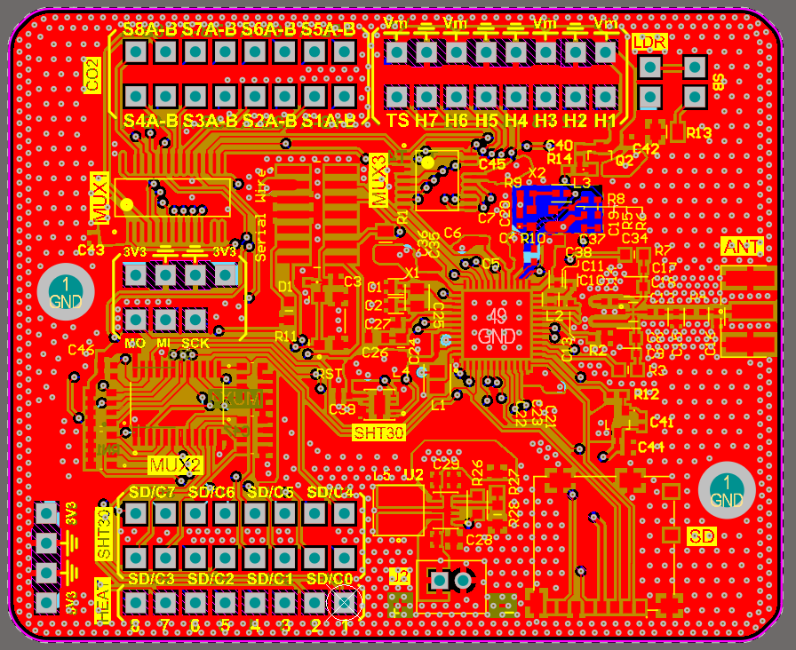
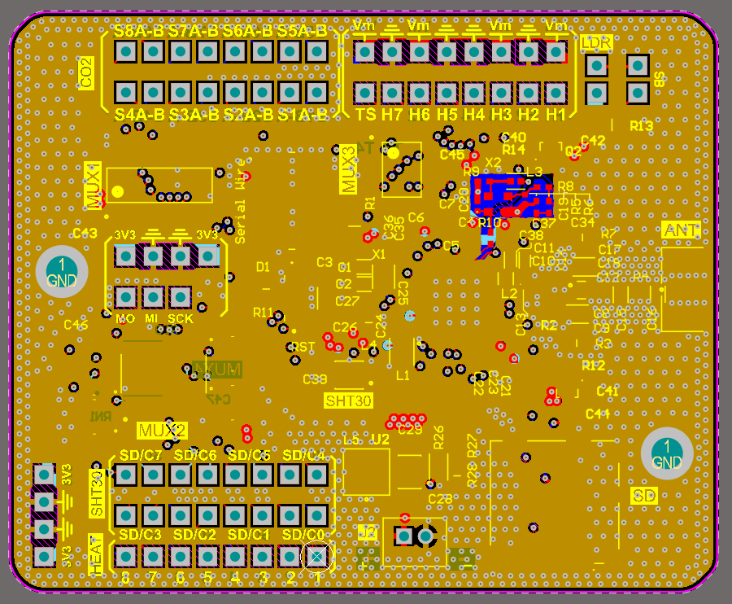
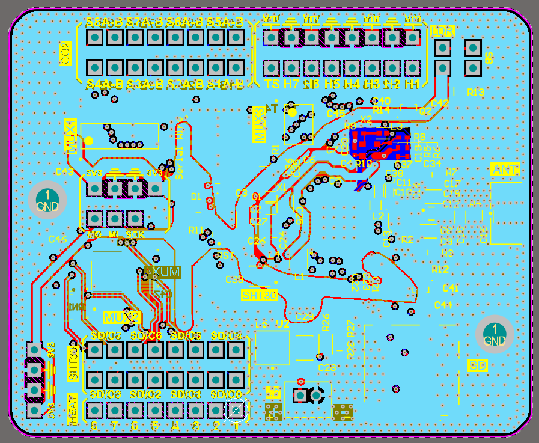
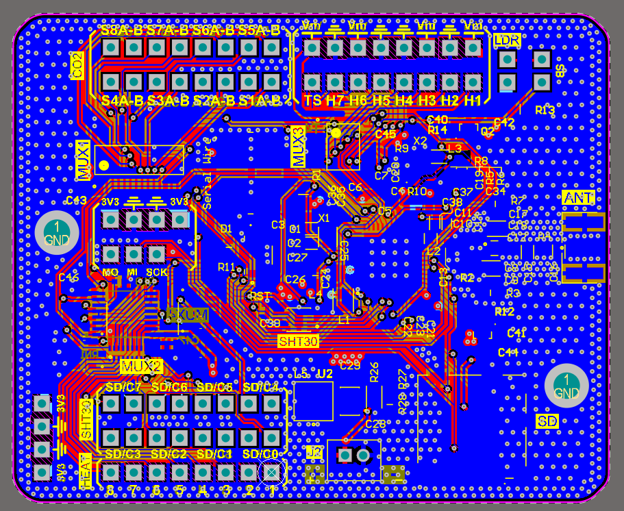
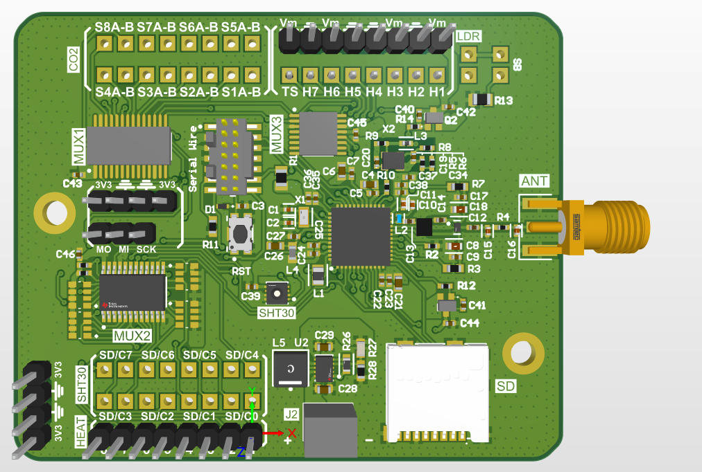

# Flux Gradient Soil

**Low-power embedded platform for distributed soil-gas CO₂ gradient measurements, environmental monitoring, and autonomous field operation.**

`Flux_Gradient_Soil` is an embedded sensing platform developed to acquire soil-gas concentration profiles for gradient-based CO₂ flux estimation. The system is built around an **STM32WL55CCU6**-based motherboard and multiple remote measurement chambers containing dedicated gas and environmental sensors.

The project is currently undergoing a substantial hardware revision focused on:

- improved CO₂ measurement chambers;
- active condensation prevention;
- lower power consumption;
- higher power-conversion efficiency;
- support for autonomous battery operation;
- compatibility with solar energy harvesting;
- improved multiplexing of distributed sensors and actuators;
- more robust long-term underground deployment.

> **Development status:** the repository currently contains firmware developed for the previous hardware revision. The architecture described below reflects the current generation of the system under development and will progressively replace the legacy design.

---

## System Overview

The system performs distributed measurements inside multiple soil-gas chambers. Each chamber is connected to a central motherboard through a flex cable.

The current architecture combines:

- **ExplorIR CO₂ sensor** for gas concentration measurements;
- **SHT30** for chamber air temperature and relative humidity;
- **TMP117** for direct thermal monitoring of the ExplorIR body;
- **flex-PCB resistive heater** wrapped around the ExplorIR;
- active heater control for condensation prevention;
- multiplexed analog acquisition;
- individually selectable heater channels;
- low-power battery operation;
- optional solar energy harvesting.

A simplified system architecture is shown below.

```text
                         ┌───────────────────────────┐
                         │        Motherboard        │
                         │                           │
 Li-ion / Harvester ───► │  Power Management        │
                         │        │                  │
                         │       3.3 V               │
                         │        │                  │
                         │   STM32WL55CCU6            │
                         │        │                  │
                         │  ┌─────┴─────┐            │
                         │  │           │            │
                         │ ADG708   SN74HC138         │
                         │  │           │            │
                         └──┼───────────┼────────────┘
                            │           │
                         Analog     Heater selection
                            │           │
                ─────────── Flex interconnect ───────────
                            │
                ┌───────────▼──────────────────────┐
                │       Measurement Chamber        │
                │                                  │
                │  ExplorIR ────────────── CO₂     │
                │                                  │
                │  SHT30 ─────── Tair + RH         │
                │                                  │
                │  TMP117 ────── TExplorIR         │
                │       │                          │
                │  Flex PCB heater                 │
                │       │                          │
                │      PMOS                        │
                │                                  │
                └──────────────────────────────────┘
```

---

## Measurement Chamber

Each measurement chamber integrates the sensing elements required to characterize both the gas concentration and the local environmental conditions.

### ExplorIR CO₂ Sensor

The **ExplorIR** provides the CO₂ concentration measurement used for the soil-gas gradient reconstruction.

The sensor is normally kept in a low-power state and is activated only during a measurement cycle. During active measurement, the sensor exhibits short current peaks of approximately **40 mA**, occurring at roughly **0.5 s intervals**.

A measurement sequence lasts approximately **20 s**, after which the sensor returns to its low-power state.

This duty-cycled operation significantly reduces the long-term energy consumption of the system.

### SHT30

The **SHT30** measures:

- chamber air temperature;
- chamber relative humidity.

These measurements are used both for environmental characterization and for estimating the local **dew-point temperature**.

The SHT30 shares the chamber I²C bus with the TMP117.

### TMP117

A dedicated **TMP117 precision temperature sensor** is mounted directly on the flex heater close to the ExplorIR body.

Its purpose is different from that of the SHT30:

| Sensor | Quantity measured |
|---|---|
| SHT30 | Air temperature inside the measurement chamber |
| SHT30 | Relative humidity inside the measurement chamber |
| TMP117 | Local temperature of the ExplorIR / heater assembly |
| ExplorIR | CO₂ concentration |

This separation makes it possible to determine whether the actual sensor body is approaching condensation conditions, rather than relying only on chamber air temperature.

---

## Condensation Prevention

Underground deployment exposes the measurement chambers to high relative humidity and potentially large thermal gradients.

The hydrophobic PTFE membranes used to protect the gas path prevent liquid water ingress while still allowing gas exchange. Water vapor can therefore enter the measurement volume.

Condensation can occur whenever a surface temperature falls below the dew-point temperature of the surrounding gas:

$$
T_\mathrm{surface} \le T_\mathrm{dew}
$$

### Dew-Point Calculation

The dew point is calculated from the air temperature and relative humidity measured by the SHT30.

The current implementation is based on the Magnus approximation:

$$
\gamma(T,RH)
=
\ln\left(\frac{RH}{100}\right)
+
\frac{aT}{b+T}
$$

with

$$
a = 17.62
$$

and

$$
b = 243.12 ^\circ\mathrm{C}
$$

followed by:

$$
T_\mathrm{dew}
=
\frac{b\gamma}{a-\gamma}
$$

where:

- \(T\) is the chamber air temperature measured by the SHT30;
- \(RH\) is the chamber relative humidity;
- \(T_\mathrm{dew}\) is the calculated dew-point temperature.

The soil temperature is **not used to calculate the dew point**. It can instead provide additional information about the thermal boundary conditions surrounding the chamber.

---

## Active Heater Control

A custom **flex-PCB resistive heater** is wrapped around the ExplorIR body.

The TMP117 is mounted directly on this flex structure so that the control system can estimate the actual temperature of the heated sensor assembly.

Rather than activating the heater according to a fixed timing schedule, the current design uses the thermal margin above the dew point:

$$
\Delta T =
T_\mathrm{ExplorIR} - T_\mathrm{dew}
$$

where:

$$
T_\mathrm{ExplorIR} \approx T_\mathrm{TMP117}
$$

A possible control strategy is:

```text
TExplorIR < Tdew + 2 °C  →  Heater ON

TExplorIR > Tdew + 4 °C  →  Heater OFF
```

The exact thresholds will be determined experimentally.

The hysteresis prevents rapid heater switching and allows the system to heat only when required, minimizing energy consumption during autonomous operation.

---

## Heater Switching Architecture

Each measurement chamber contains a **P-channel MOSFET high-side switch** controlling its flex heater.

The heater supply is derived from the regulated **3.3 V system rail**.

```text
                3.3 V
                  │
                  │
               Source
             ┌────────┐
             │ PMOS   │
             └────────┘
               Drain
                  │
                  │
             Flex Heater
                  │
                 GND
```

The PMOS gate is controlled through the chamber flex cable.

Because the heater supply and digital control logic both operate from the regulated 3.3 V rail, the PMOS can be driven directly by the active-low heater-selection signal.

A local gate-to-source pull-up keeps the PMOS switched off if the control line becomes disconnected or high-impedance.

---

## Heater Channel Selection

The motherboard uses an **SN74HC138PWR 3-to-8 decoder** to select individual heater channels.

Three address lines select one of up to eight chambers.

The decoder is configured with:

```text
G2A = GND
G2B = GND

G1 = MCU-controlled enable
     + 100 kΩ pull-down
```

The `G1` pull-down provides a fail-safe state during MCU reset.

When `G1` is low, the decoder is disabled and all heater outputs remain inactive.

When enabled, the SN74HC138 produces one active-low output:

```text
Selected chamber       → Yx = LOW
Non-selected chambers  → Yx = HIGH
```

This behavior is particularly convenient for the PMOS high-side heater switch:

```text
Yx = LOW   → PMOS ON  → Heater ON

Yx = HIGH  → PMOS OFF → Heater OFF
```

A **YC248-JR-07220RL** resistor network provides **220 Ω series resistance** between the decoder outputs and the flex-cable heater-control lines.

---

## Analog Channel Multiplexing

Analog channels are handled separately from the heater-control signals.

An **ADG708 analog multiplexer** routes one of multiple analog signals to the MCU ADC input.

This distinction is important:

- the **SN74HC138** performs digital actuator selection;
- the **ADG708** physically routes an analog voltage to the ADC.

```text
Analog Channel 0 ──┐
Analog Channel 1 ──┤
Analog Channel 2 ──┤
Analog Channel 3 ──┤
Analog Channel 4 ──┤
Analog Channel 5 ──┤
Analog Channel 6 ──┤
Analog Channel 7 ──┤
                   │
                ADG708
                   │
                   ▼
                MCU ADC
```

This architecture allows several distributed analog measurements to share a single ADC input while preserving the original analog information.

---

## Chamber Flex Interface

The current chamber interface uses a **10-conductor flex connection**.

The proposed signal allocation is:

| Pin | Signal | Function |
|---:|---|---|
| 1 | GND | Ground |
| 2 | SDA | I²C data |
| 3 | GND | Ground / return |
| 4 | SCL | I²C clock |
| 5 | 3V3 | Chamber power |
| 6 | 3V3 | Parallel chamber/heater power |
| 7 | HEATER_CTRL | Active-low heater control |
| 8 | UART TX | ExplorIR serial communication |
| 9 | UART RX | ExplorIR serial communication |
| 10 | GND | Ground / high-current return |

The two 3.3 V conductors are intentionally paralleled to reduce voltage drop during heater operation.

Similarly, multiple ground conductors reduce common-impedance coupling between:

- heater current;
- digital communication;
- sensor power;
- analog measurements.

The exact trace resistance and current capability of the flex cable must be verified against the final heater power.

---

## Power Architecture

The original hardware uses an **LD39050PU33R 3.3 V LDO**.

The current redesign targets a more efficient switching power architecture because the system combines:

- very low average current during sleep;
- short sensor-current peaks;
- potentially several hundred milliamperes of heater load;
- battery operation;
- optional solar energy harvesting.

### 3.3 V Buck-Boost Regulation

The current target is a **TPS63802 synchronous buck-boost converter** configured for a regulated 3.3 V output.

A buck-boost topology is preferred over a conventional buck regulator because a single-cell Li-ion battery spans approximately:

$$
4.2~\mathrm{V}
\rightarrow
3.0~\mathrm{V}
$$

during discharge.

The converter can therefore:

```text
VBAT > 3.3 V   → buck operation

VBAT ≈ 3.3 V   → buck-boost transition

VBAT < 3.3 V   → boost operation
```

while maintaining:

$$
V_\mathrm{SYS}=3.3~\mathrm{V}
$$

The power stage is being designed with sufficient margin for a system output current of at least:

$$
I_\mathrm{OUT} \ge 700~\mathrm{mA}
$$

This margin allows the system to accommodate heater loads whose final resistance and duty cycle are still being experimentally characterized.

### Why the Heater Uses the Regulated Rail

Using the common regulated 3.3 V rail provides several advantages:

- constant heater voltage independent of battery state;
- predictable heater resistance and power;
- simpler PMOS gate drive;
- no additional VBAT conductor required in the chamber flex cable;
- straightforward power-budget calculations;
- consistent behavior across measurement chambers.

The two existing 3.3 V flex conductors can therefore remain available in parallel for power delivery.

---

## Optional Solar Energy Harvesting

An external energy-harvesting board based on the **BQ25504** is also being investigated.

The intended role of this board is to harvest energy from a photovoltaic cell and recharge the system energy storage.

A conceptual architecture is:

```text
 Solar Cell
     │
     ▼
  BQ25504
     │
     ▼
 Li-ion Battery
     │
     ▼
 TPS63802
     │
     ▼
 Regulated 3.3 V System Rail
```

The battery acts as the energy reservoir for high-current events such as heater activation.

This separation is important because the solar harvester is intended to replenish energy over longer timescales, while the battery supplies short-duration high-power loads.

---

## Power-Consumption Strategy

The system is designed around a highly duty-cycled operating profile.

Most subsystems remain inactive whenever possible.

A typical measurement cycle is conceptually:

```text
System sleep
    │
    ▼
Wake-up
    │
    ├── Environmental measurements
    │     ├── SHT30
    │     └── TMP117
    │
    ├── Dew-point evaluation
    │
    ├── Heater activation if required
    │
    ├── ExplorIR wake-up
    │
    ├── CO₂ acquisition
    │
    ├── Data processing/storage/transmission
    │
    ▼
Return to sleep
```

The objective is to keep the long-term average power consumption low enough for battery-powered and energy-harvesting field deployments while retaining sufficient instantaneous power for heating and gas measurement.

---

## PCB Development

The new hardware revision integrates the updated power architecture, distributed chamber interface, sensor multiplexing, heater control, and protection circuitry.

### PCB Layer Views

Store the exported PCB-layer images in:

```text
docs/images/pcb/
```

Recommended filenames:

```text
docs/images/pcb/top_copper.png
docs/images/pcb/inner_1.png
docs/images/pcb/inner_2.png
docs/images/pcb/bottom_copper.png
docs/images/pcb/pcb_3d.png
```

Then the following section will render them directly on GitHub.

#### Top Copper



#### Inner Layer 1



#### Inner Layer 2



#### Bottom Copper



### 3D PCB View



---

## Firmware

The firmware is designed for the **STM32WL55CCU6** platform.

The software is responsible for coordinating:

- low-power system operation;
- measurement scheduling;
- ExplorIR communication;
- SHT30 acquisition;
- TMP117 acquisition;
- dew-point calculation;
- heater-channel selection;
- heater hysteresis control;
- analog channel multiplexing;
- ADC acquisition;
- data processing;
- system power management.

The repository currently contains firmware developed for the previous hardware revision under:

```text
CO2_gradient/
```

The firmware will evolve together with the new motherboard and measurement-chamber architecture.

---

## Current Development Focus

The current hardware and firmware development is focused on:

1. finalizing the high-efficiency 3.3 V buck-boost power stage;
2. characterizing the flex-PCB heater;
3. determining the required heater resistance and thermal power;
4. validating TMP117 thermal coupling to the ExplorIR body;
5. experimentally determining condensation-control thresholds;
6. validating the SHT30-based dew-point estimation;
7. characterizing voltage drop along the chamber flex cables;
8. validating heater switching through the SN74HC138 and PMOS stages;
9. integrating the updated hardware into the STM32 firmware;
10. evaluating autonomous operation with a BQ25504-based photovoltaic harvesting module.

---

## Design Philosophy

The project follows three main design principles.

### Measure locally

CO₂ concentration, air temperature, relative humidity, and sensor-body temperature are measured as close as possible to the physical process of interest.

### Heat only when necessary

The anti-condensation heater is controlled using actual dew-point margin rather than a fixed periodic heating schedule.

This minimizes energy consumption while protecting the optical CO₂ sensor.

### Separate average power from peak power

The system is designed for very low average consumption but must tolerate substantially larger instantaneous loads.

Battery storage and the main DC/DC converter therefore handle short high-power events, while an optional photovoltaic harvester replenishes energy over much longer timescales.

---

## Repository

```text
Flux_Gradient_Soil/
│
├── CO2_gradient/           # STM32 firmware
│
├── docs/
│   └── images/
│       └── pcb/
│           ├── top_copper.png
│           ├── inner_1.png
│           ├── inner_2.png
│           ├── bottom_copper.png
│           └── pcb_3d.png
│
├── .gitignore
└── README.md
```

---

## Project Scope

This repository documents an ongoing research platform for **in-situ soil-gas monitoring and gradient-based CO₂ flux measurements**.

The hardware and firmware remain under active development. Component selection, PCB layout, heater characteristics, measurement timing, and power-management strategies may change as laboratory and field characterization progresses.
